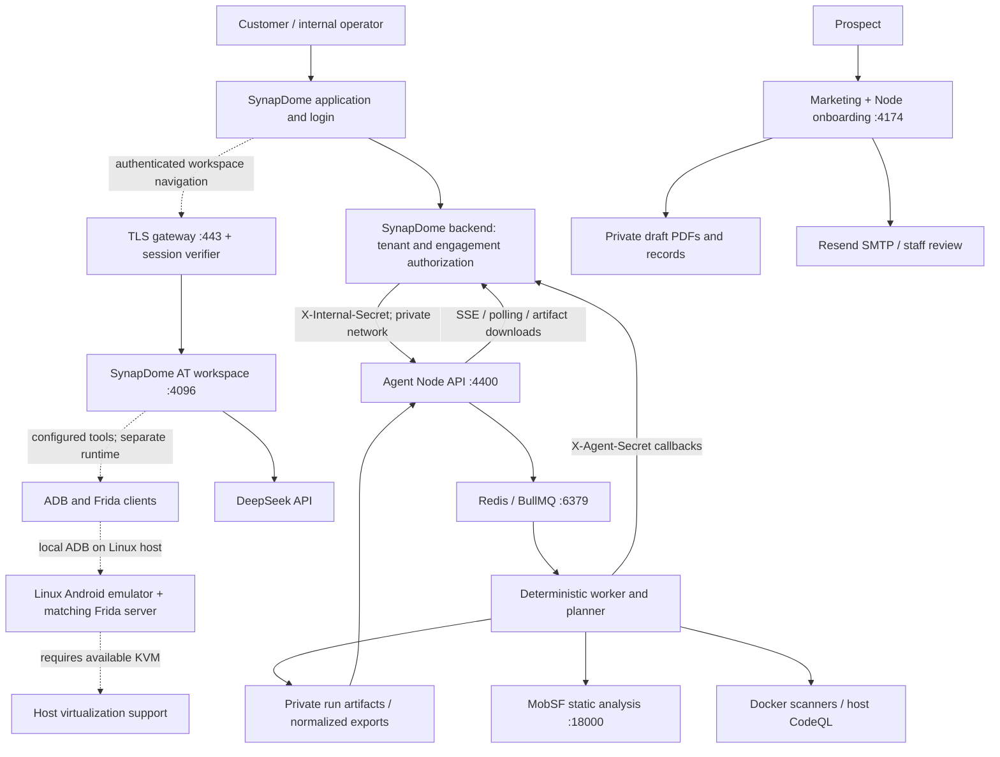

# SynapDome Red Team architecture

Reviewed against repository source on 26 November 2026.

Solid edges represent implemented component behavior or the supplied deployment topology; dotted edges need deployment configuration or application integration. The main SynapDome login/backend is external to this repo. This diagram does not claim those external connections are live.

The required mobile topology is entirely server-local, without a Mac tunnel. It is not yet operational on the current host; see [Linux mobile deployment](linux-mobile-deployment.md).

## Modules and boundaries

| Module | Source | Responsibility / current state |
|---|---|---|
| Scanner API and worker | `src/api`, `src/worker`, `src/agent` | Queued deterministic scans; normalized findings, callbacks, SSE and artifact retrieval |
| SynapDome AT | `deploy/synapdome-ui` | Branded CyberStrike-derived operator workspace, reconstructed using pinned source + patch; independent engine/session store |
| Mobile dynamic lab | `deploy/synapdome-ui/mobile` | Required topology: Linux-local emulator, ADB and Frida; current host lacks KVM. Mac scripts retained as legacy reference; not a BullMQ dynamic adapter |
| Mobile static service | `src/tools/mobsf.ts`, Compose | MobSF APK/package analysis; Android and iOS package acceptance does not imply an iOS emulator |
| Marketing / onboarding | `Synap AT/public`, `src/onboarding` | PDF scope preview, private records and email review; no automatic scan kickoff |

**Naming:** the existing `Synap AT/` directory is the marketing site, not the CyberStrike-derived workspace. Keep legacy folder names, `cyberstrike` config directories and service names for compatibility; the product name is SynapDome AT.

## Integration contract

1. Main backend validates user, tenant, engagement, scope and tool entitlement.
2. Backend submits `POST /runs`, retaining the returned run ID. Use `X-Internal-Secret`, not a frontend-stored credential.
3. Backend consumes `/runs/:runId/stream` or polls `/runs/:runId`.
4. For `awaiting_input`, collect input and send `POST /runs/:runId/input`.
5. Ingest `exports/synapdome-export.json`; directory discovery additionally uses `exports/directory-results.json`; web DAST exposes `exports/dast-report.html`.
6. Authenticate callbacks using `X-Agent-Secret`; validate run/tenant association and deduplicate ingestion.

No automatic AT-to-Agent-Node bridge has been established by this handoff. A developer must explicitly configure or implement a server-side tool/client bridge before claiming the AT UI dispatches every queued scanner. The workspace's upstream tools/MCP capabilities are separate from the adapter inventory in this repo.

## Deployment boundaries

Only HTTPS gateway ports are intended to be public. Keep API 4400, AT 4096, Redis 6379, MobSF 18000, onboarding 4174, ADB 5037/15037 and Frida 27042/27044 private or loopback. Onboarding is public only through its HTTPS proxy.

AT gateway requires an actual SynapDome session-verification endpoint. Its packaged contract is not a login implementation. A valid login must also have workspace permission. AT remains an internal operator workspace until per-tenant execution, files and credentials are isolated.

The Agent API uses a shared service credential; supplied tenant IDs are not independently authenticated customer identities. Keep it behind a trusted backend. An unset secret disables API authentication. Docker access is privileged: dedicate the worker host and do not colocate customer secrets unrelated to scanning.

Several adapters explicitly use Docker bridge networking even when `DOCKER_NETWORK=none`; policy labels are not an egress firewall. Enforce authorized destination access at the runner/network boundary. Cancellation and timeout handling do not guarantee termination of every child container.

## Persistence and recovery

Back up Redis volume, `ARTIFACT_ROOT`, tool caches as appropriate, MobSF volume, AT service data/config and onboarding private data. Encrypt access-sensitive evidence and restrict retention. Never include these in Git or release archives. A code deployment cannot recover inaccessible AWS databases; restore an approved backup separately.

## Open production work

- Restore/select hosting; validate actual OS, capacity, architecture, DNS and TLS.
- Connect real SSO/session verification and enforce tenant isolation before customer AT access.
- Complete AT-to-scanner bridge in the main backend.
- Validate scanner execution and model connectivity on the chosen host; pin floating image digests and CodeQL bundle.
- Validate runner tunnel, reconnect behavior and app navigation. Linux/cloud emulator equivalence remains unverified.
- Cloud, identity, network recon, Drozer, Objection and dedicated API/GraphQL workflows are not implemented Agent Node adapters in this checkout. GCP account provisioning is not a GCP scanner implementation.
